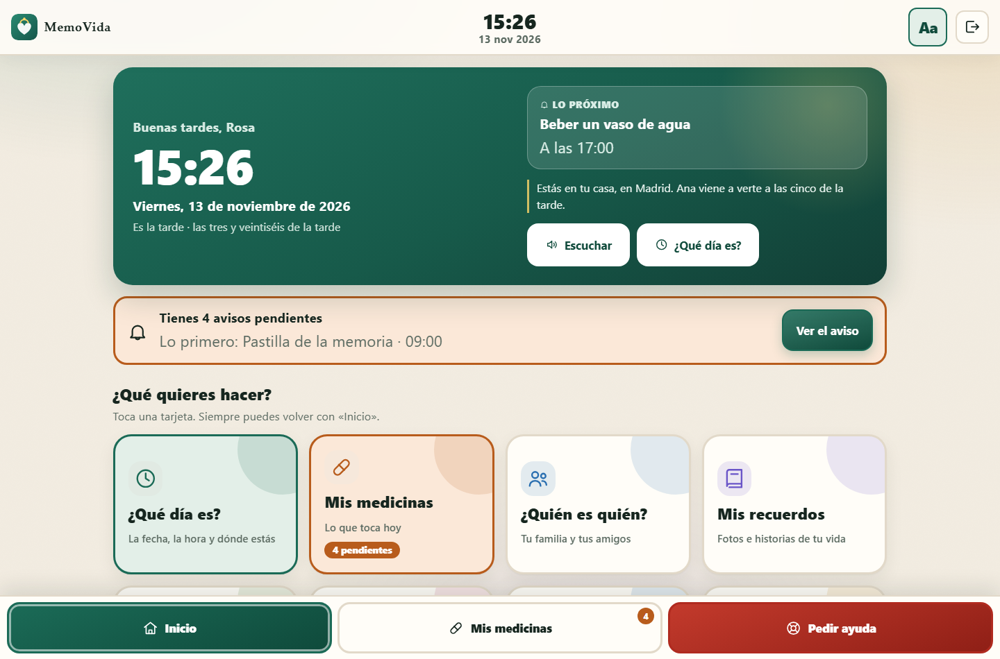
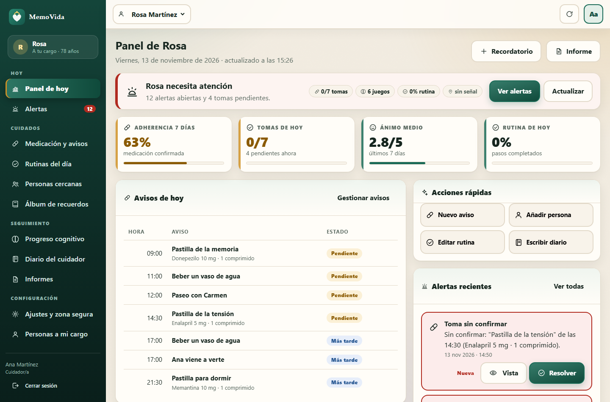
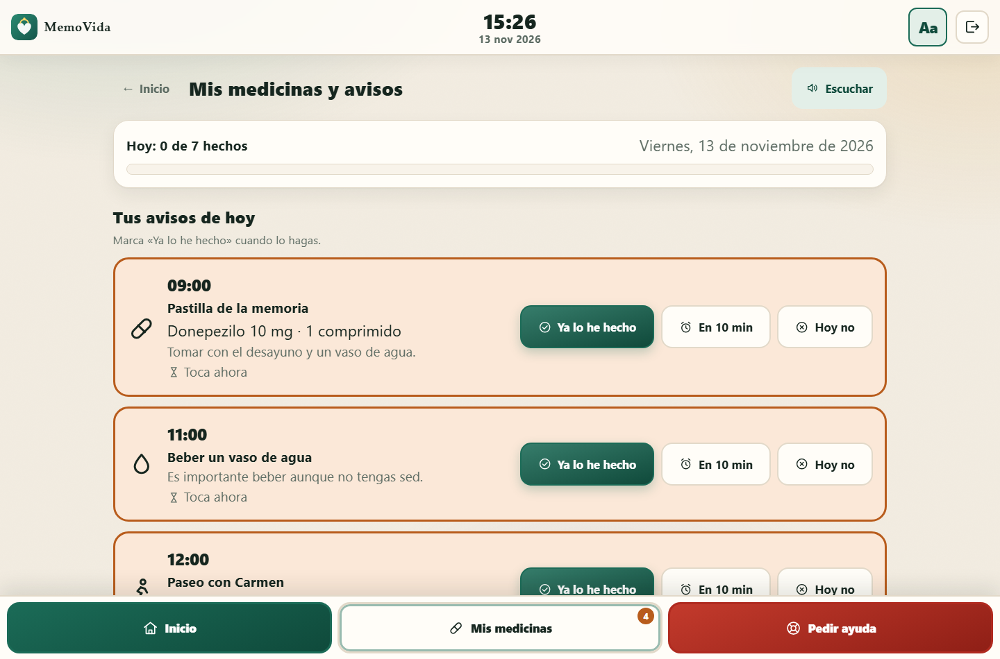
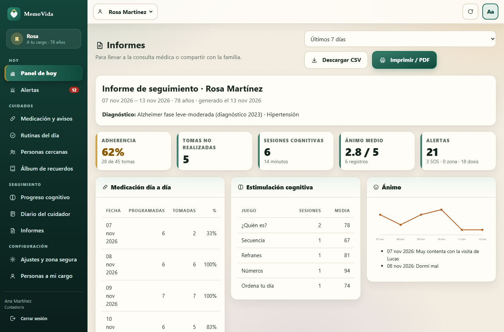
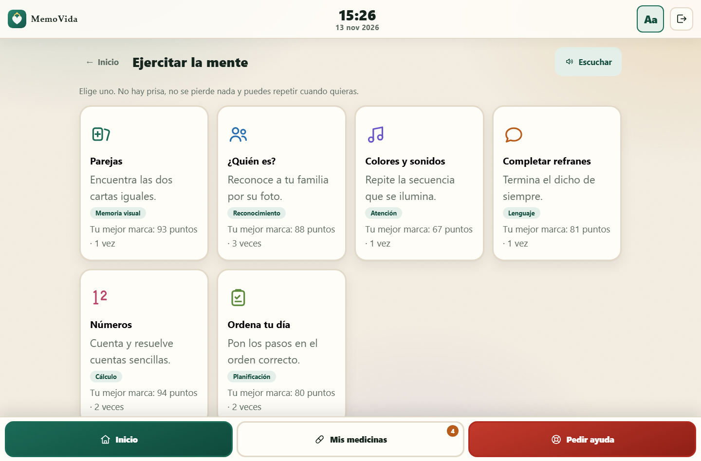
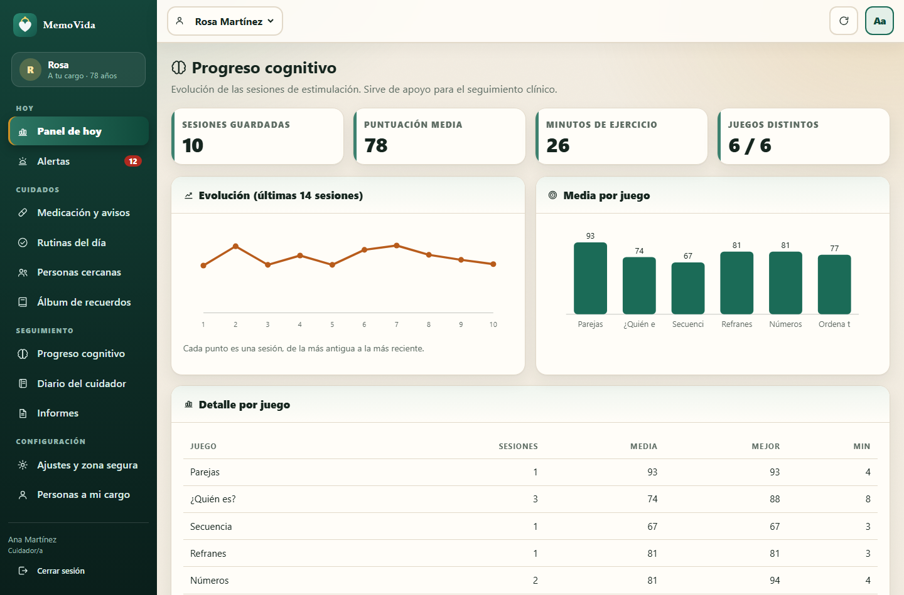
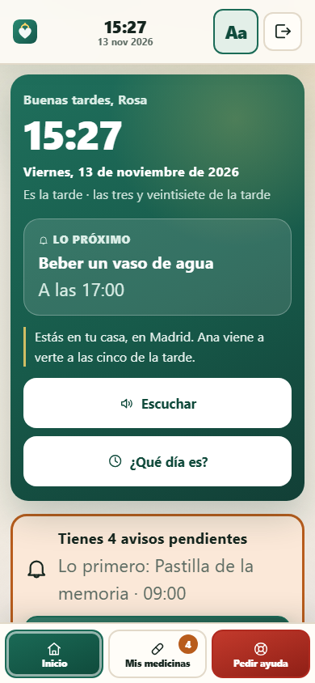
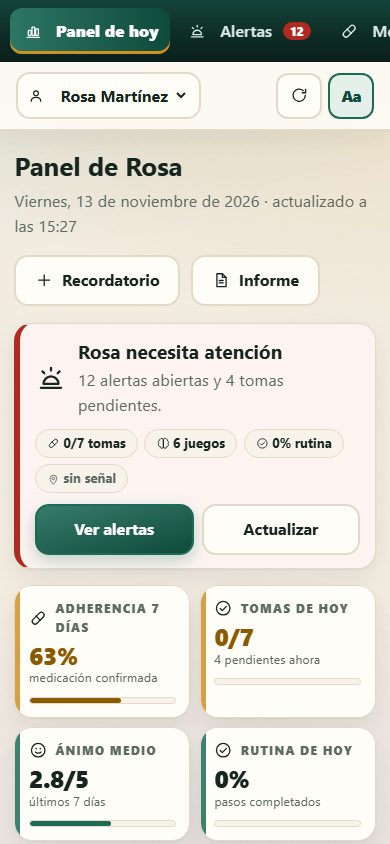
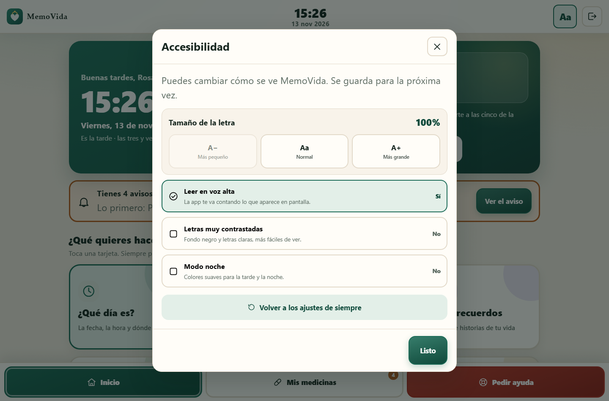

# 🧠 MemoVida

**Asistente digital para personas con Alzheimer (fase leve-moderada) y sus cuidadores.**

Aplicación web completa y accesible: orientación temporal, recordatorios de medicación, reconocimiento de familiares, terapia de reminiscencia, rutinas guiadas, estimulación cognitiva, calma, ánimo, SOS con geocerca y panel de control para el cuidador.

| | |
|---|---|
| **Demo pública** | https://eduerking-crypto.github.io/memovida/ |
| **Código** | https://github.com/eduerking-crypto/memovida |
| **APK Android** | https://github.com/eduerking-crypto/memovida/releases/latest |
| **Cuenta paciente** | `rosa@memovida.app` / `rosa1234` |
| **Cuenta cuidadora** | `ana@memovida.app` / `ana1234` |

> ⚠️ MemoVida es una herramienta de apoyo, **no** un producto sanitario ni un sustituto del criterio médico.
> No introduzcas datos reales de salud en la demo pública: la demo guarda todo **en tu propio navegador**.

## 🆕 Novedades 1.1 · más fácil y más amable

- **Inicio del paciente con un «Ahora» claro**: hora grande, fecha en palabras, lo próximo que toca y un botón para escucharlo. Lo urgente (avisos pendientes) aparece siempre arriba.
- **Barra inferior de tres destinos**: Inicio · Mis medicinas (con contador) · Pedir ayuda. Siempre a un toque.
- **Un solo botón «Aa»** abre la accesibilidad explicada en palabras: voz, tamaño de letra, contraste y modo noche, con vista previa inmediata.
- **Panel del cuidador con estado en una frase** («Rosa necesita atención»), cuatro indicadores con barra, acciones rápidas y una columna lateral ordenada.
- **Menú del cuidador por grupos**: Hoy · Cuidados · Seguimiento · Configuración. En móvil se convierte en una tira horizontal desplazable.
- **Estados vacíos útiles** con icono, explicación y un botón para continuar (nunca una pantalla en blanco).
- **Modo noche y alto contraste revisados** para que todos los botones y etiquetas sigan siendo legibles.

## 📸 Capturas

| Modo paciente | Modo cuidador |
|---|---|
|  |  |
|  |  |
|  |  |
|  |  |



---

## 🚀 Lo que puedes hacer

### Modo paciente
- **Inicio «Ahora»** — hora grande, fecha en palabras, lo próximo que toca y frase de anclaje. Los avisos pendientes siempre arriba.
- **¿Qué día es hoy?** — orientación, parte del día, estación, foto del entorno.
- **Mis medicinas** — avisos a su hora con voz, "Ya la tomé" / "Recordarme en 10 min", con progreso del día.
- **¿Quién es quién?** — fichas de familiares con foto, parentesco y un recuerdo; botón de llamada.
- **Mis recuerdos** — álbum y línea de vida con narración en voz alta.
- **Mi día** — rutinas paso a paso (mañana / tarde / noche) con progreso visible.
- **Ejercitar la mente** — 6 juegos adaptativos con 3 niveles cada uno.
- **Calmarme** — respiración guiada 4-4-6.
- **Pedir ayuda** — SOS con ubicación y ficha de emergencia imprimible.
- **Barra inferior fija**: Inicio · Mis medicinas · Pedir ayuda, siempre a mano.

### Modo cuidador
- Panel del día con **estado en una frase**, cuatro indicadores con barra, avisos, alertas y gráficas.
- **Acciones rápidas**: nuevo aviso, añadir persona, editar rutina, escribir diario.
- Menú agrupado: Hoy · Cuidados · Seguimiento · Configuración.
- CRUD completo: recordatorios, personas, recuerdos, rutinas y diario.
- Alertas SOS / geocerca / dosis olvidada, con acuse y respuesta.
- Progreso cognitivo con gráficas SVG dibujadas a mano.
- Informe semanal imprimible + exportación CSV.
- Ajustes remotos de accesibilidad y zona segura.

### Accesibilidad
Botones ≥ 88 px · tipografía 22–40 px escalable · contraste ≥ 7:1 · `aria-live` · navegación completa por teclado · foco visible de 4 px · sin límites de tiempo, sin dobles clics y sin arrastrar · `prefers-reduced-motion` · modo noche · lectura en voz alta.

Todo se ajusta desde **un único botón «Aa»** con opciones escritas en palabras y vista previa inmediata.

---

## 🏗️ Arquitectura

```
Navegador ── HTML + CSS + JS (ES modules, sin frameworks, sin CDN)
   │  api.js (fetch + token) · store.js (estado + caché) · router hash
   │  REST JSON /api/*        SSE /api/stream
   ▼
Node.js 20+ · node:http · CERO dependencias npm
   server.js  → estáticos + router + SSE
   src/api.js → auth, pacientes, personas, recuerdos, recordatorios,
                tomas, rutinas, ánimos, juegos, alertas, ubicaciones,
                notas e informes
   src/db.js  → almacén JSON atómico
   src/auth.js→ scrypt + tokens de sesión
   src/engine.js → motor de avisos (cada 30 s)
   src/bus.js → eventos en vivo
   ▼
data/db.json (persistente, se crea con datos demo)
```

| Capa | Tecnología |
|---|---|
| Frontend | HTML5 + CSS3 + JavaScript ES2022 (módulos, sin frameworks) |
| Backend | Node.js puro (`node:http`, `node:crypto`) — 0 dependencias |
| Persistencia | JSON documental con escritura atómica (tmp + rename) |
| Tiempo real | Server-Sent Events |
| Voz / audio | Web Speech API · Web Audio API |
| Gráficas | SVG generado a mano |

### Modelo de datos
`users`, `sessions`, `patients`, `people`, `memories`, `reminders`, `doseLogs`, `routines`, `routineLogs`, `moods`, `gameScores`, `alerts`, `locations`, `notes`.
Toda consulta se filtra por el permiso del usuario autenticado.

### API REST (resumen)

| Método | Ruta | Descripción |
|---|---|---|
| POST | `/api/auth/register` · `/login` · `/logout` | Alta, acceso, salida |
| GET | `/api/auth/me` | Sesión actual |
| GET | `/api/bootstrap?patientId=` | Todo el estado del paciente en 1 llamada |
| GET/PATCH | `/api/patients/:id` | Perfil, zona segura, accesibilidad |
| POST | `/api/patients/link` | Vincular por código de 6 caracteres |
| CRUD | `/api/people` · `/memories` · `/reminders` · `/routines` · `/notes` | Gestión |
| POST | `/api/doses` | Confirmar / posponer / omitir toma |
| GET | `/api/reminders/due` | Avisos pendientes ahora |
| POST | `/api/routines/:id/step` | Marcar paso de rutina |
| POST | `/api/moods` · `/api/games` | Ánimo y puntuaciones |
| POST | `/api/alerts/sos` · `/api/locations` | Ayuda y posición |
| PATCH | `/api/alerts/:id` | Atender / resolver alerta |
| GET | `/api/reports/weekly` · `/api/reports/export.csv` | Informes |
| GET | `/api/stream?token=` | Canal SSE |

---

## 💻 Ejecutar en local (app completa)

Requiere **Node.js ≥ 18** (sin `npm install`).

```bash
node server.js
# → http://localhost:3000
```

Otros comandos:

```bash
npm run dev      # recarga automática
npm test         # smoke test de la API de extremo a extremo
npm run reset    # borra data/db.json (se vuelve a sembrar al arrancar)
PORT=8080 node server.js
```

Variables de entorno: `PORT` (3000), `HOST` (0.0.0.0), `DATA_DIR` (`./data`).

---

## 🌐 Demo estática (GitHub Pages)

La app real necesita su servidor Node. Para poder **compartir un enlace público sin servidor**, el proyecto incluye una compilación estática que ejecuta *el mismo código de dominio* dentro del navegador:

- `tools/build-demo.mjs` copia `public/` a `docs/` y reescribe los módulos de `src/` para el navegador.
- `docs/js/shims/*` sustituyen `node:fs`, `node:path`, `node:crypto` y `node:url`.
- La persistencia usa `localStorage` (no sale de tu dispositivo).
- `fetch` y `EventSource` se interceptan para responder `/api/*` en memoria.

```bash
node tools/build-demo.mjs     # regenera docs/
node tools/serve-demo.mjs     # previsualiza en http://localhost:4173
```

GitHub Pages sirve la carpeta `docs/` de la rama `main`.

> La demo es **mono-dispositivo**: paciente y cuidador deben entrar en el mismo navegador para verse entre sí. La app completa con servidor sí es multiusuario y en tiempo real.

---

## 📱 App Android (APK)

El APK empaqueta la demo estática dentro de un WebView: **funciona sin internet** y guarda los datos en el dispositivo.

**Descarga:** https://github.com/eduerking-crypto/memovida/releases/latest (`MemoVida-1.1.0.apk`, 3,7 MB)

```bash
node tools/build-demo.mjs
node tools/build-apk.mjs      # requiere Android SDK + JDK 21
# → build/MemoVida-1.1.0.apk y build/MemoVida.apk
```

Detalles técnicos:

- `minSdk 24` (Android 7.0) · `targetSdk 35` (Android 15) · compatible con Android 7 → 16.
- WebView con `WebViewAssetLoader` propio (`shouldInterceptRequest`) sirviendo `assets/public` desde `https://appassets.local`.
- Sin dependencias de AndroidX ni Gradle: compila con `aapt2` + `d8` + `apksigner` del SDK.
- Permisos: `INTERNET` (enlaces externos) y `ACCESS_FINE_LOCATION` (SOS y zona segura).

Instalación en el teléfono:

1. Copia `MemoVida.apk` al teléfono (cable, WhatsApp, Drive…).
2. Ábrelo y acepta **"Instalar apps desconocidas"** para esa fuente.
3. Listo. No requiere conexión.

---

## 🔒 Seguridad y privacidad

- Contraseñas con **scrypt** (N=16384) y salt por usuario; comparación en tiempo constante.
- Tokens de sesión de **256 bits** con caducidad de 30 días.
- Validación y saneado de todo el cuerpo de las peticiones; límite de 2 MB.
- Cabeceras CSP, `nosniff` y `Referrer-Policy: no-referrer`.
- Sin analítica, sin cookies de terceros, sin CDN.
- Cero dependencias npm en producción → superficie de ataque mínima.

---

## 📄 Licencia

MIT © Eduer Perez
